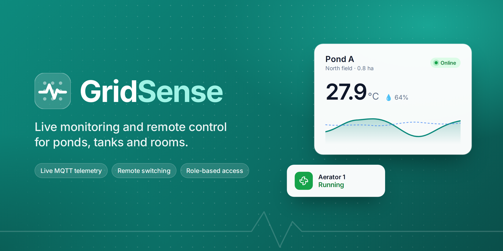
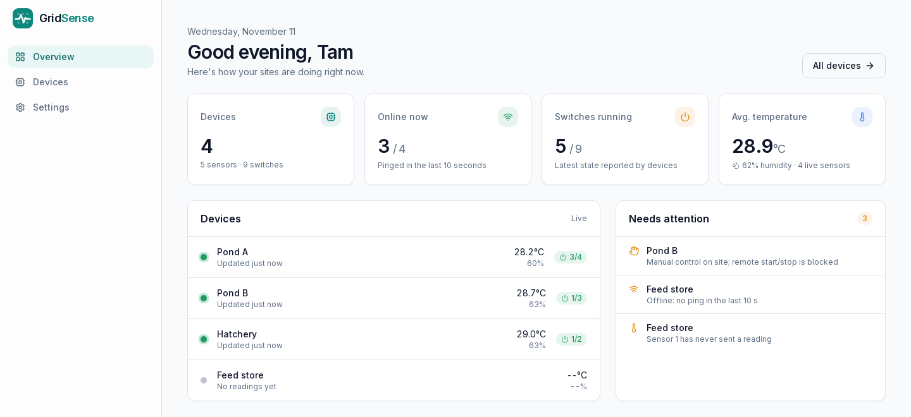
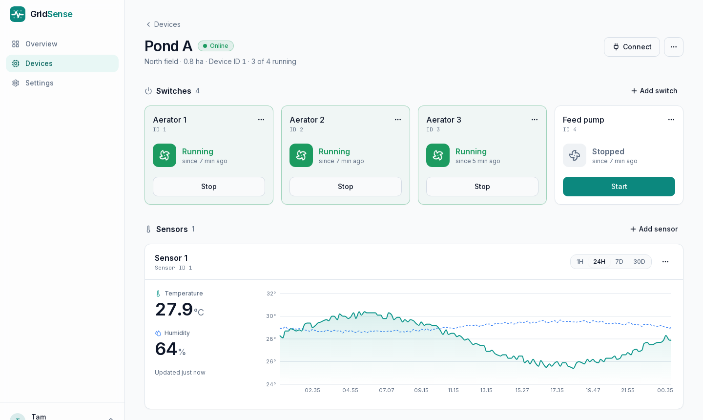
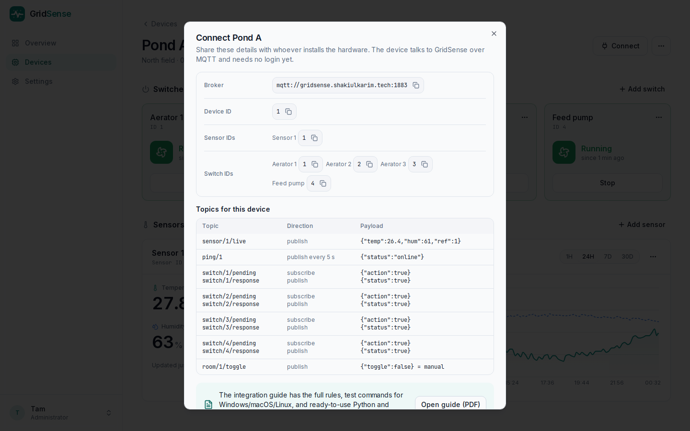
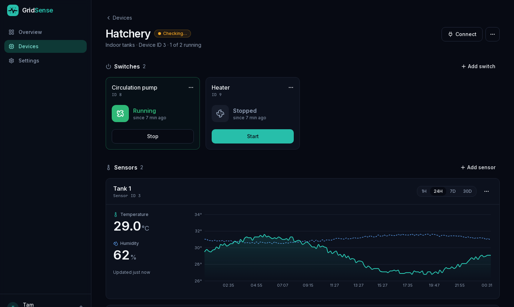
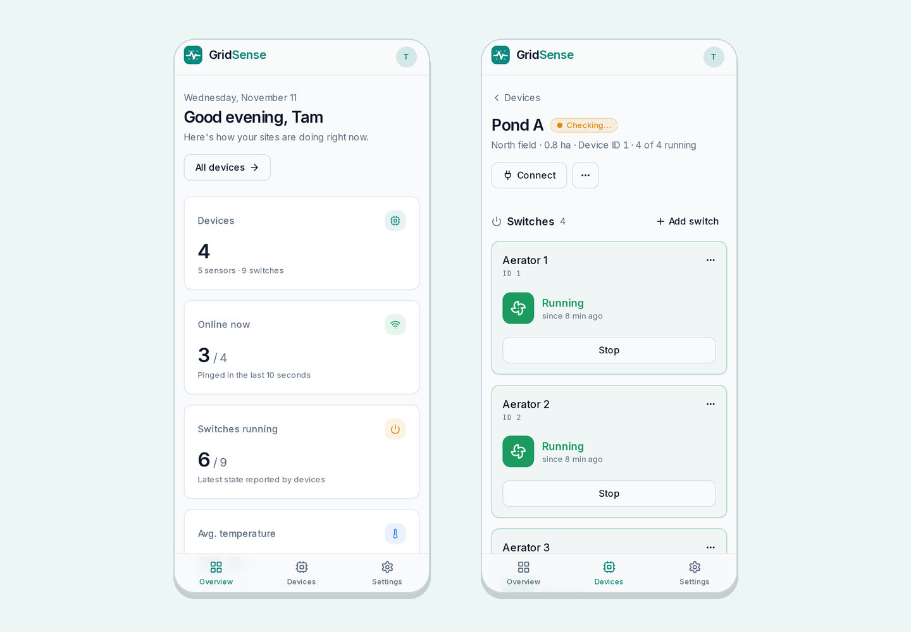
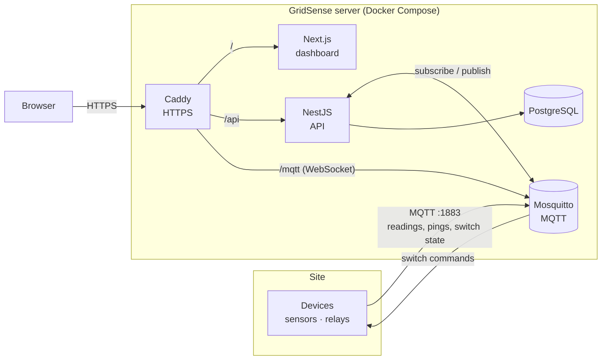

<p align="center">
  
</p>

<p align="center">
  <a href="https://github.com/tam11a/gridsense/actions/workflows/ci.yml"></a>
  
  
  
  
  
</p>

<p align="center">
  <a href="https://gridsense.shakiulkarim.tech"><b>Live app</b></a> ·
  <a href="docs/GridSense-Device-Integration-Guide.pdf"><b>Device guide (PDF)</b></a> ·
  <a href="https://gridsense.shakiulkarim.tech/api/docs"><b>API docs</b></a> ·
  <a href="docs/CHANGELOG.md"><b>Changelog</b></a>
</p>

---

GridSense watches over field sites such as fish ponds, hatchery tanks and
store rooms. Sensors stream temperature and humidity over MQTT, the dashboard
shows them live with history, and operators start and stop aerators and
pumps remotely. Each command is confirmed by the device, and remote control
is blocked while someone runs the site in manual mode.

## Contents

- [Screenshots](#screenshots)
- [Features](#features)
- [How it works](#how-it-works)
- [Deploy](#deploy)
- [Connecting devices](#connecting-devices)
- [Roles](#roles)
- [Configuration](#configuration)
- [Development](#development)
- [Operations](#operations)
- [Project structure](#project-structure)
- [Security notes](#security-notes)

## Screenshots

<table>
  <tr>
    <td width="50%"><br><sub><b>Overview:</b> live status across every site, plus what needs attention.</sub></td>
    <td width="50%"><br><sub><b>Device:</b> start and stop switches, with 24-hour temperature and humidity.</sub></td>
  </tr>
  <tr>
    <td width="50%"><br><sub><b>Connect:</b> every ID and topic a hardware engineer needs.</sub></td>
    <td width="50%"><br><sub><b>Dark mode</b>, following the system setting or chosen per user.</sub></td>
  </tr>
  <tr>
    <td colspan="2"><br><sub><b>Mobile:</b> the full app on a phone, with bottom navigation.</sub></td>
  </tr>
</table>

## Features

| | |
| --- | --- |
| **Live readings** | Temperature and humidity pushed over MQTT and shown instantly; online/offline from device pings or any other message the device sends. |
| **Remote control** | Start/stop switches from the dashboard. The UI waits for the device to confirm and warns if it doesn't. |
| **Manual mode** | A device can hand control to on-site staff; remote commands are refused until it hands back. |
| **History** | 1 h / 24 h / 7 d / 30 d charts, averaged server-side so long ranges stay fast; CSV export. |
| **Device management** | Add devices, sensors and switches, rename them, and get connection details to hand to installers. |
| **Team and roles** | Administrator, Operator and Viewer roles, enforced by the API; invite, deactivate and remove members. |
| **Self-hosted** | One `docker compose up` on any Linux server, with automatic HTTPS. |

## How it works



- Devices publish readings and state to Mosquitto. The API stores them in
  PostgreSQL, and browsers receive them live over a WebSocket at `/mqtt`.
- Browsers **never** send commands to the broker. A switch command goes to
  `POST /api/switches/:id/action`, which checks the user's role and manual
  mode before publishing `switch/<id>/pending`.
- Caddy is the only public web entry point. The API, dashboard and database
  aren't exposed directly.

## Deploy

Any Linux host with Docker and a domain pointing at it. Open ports 80, 443 and 1883.

```bash
git clone git@github.com:tam11a/gridsense.git && cd gridsense
cp .env.example .env
```

Fill in `.env` (see [Configuration](#configuration)), then:

```bash
docker compose up -d --build
```

| URL | |
| --- | --- |
| `https://<domain>` | Dashboard |
| `https://<domain>/api/docs` | Swagger API docs |
| `https://<domain>/api/health` | Health check (database and broker) |
| `mqtt://<domain>:1883` | Device connection |

On every start the API applies database migrations, creates the default roles,
and creates the first admin from `ADMIN_EMAIL` / `ADMIN_PASSWORD` if that account
doesn't exist. To update, pull and run `docker compose up -d --build` again.

### Running GridSense 1.x alongside

[`legacy/`](legacy) holds the 1.x (iot-101) API and dashboard as they were at
the merge, with three changes: login accepts the bcrypt passwords that 2.x
stores, every API route except login requires a token, and the old seed (a
hard-coded account) is not run. To serve it on its own hostname, set
`GRIDSENSE_LEGACY_DOMAIN` and
`COMPOSE_FILE=docker-compose.yml:docker-compose.legacy.yml` in `.env`, then
run `docker compose up -d --build`. It shares the broker but uses its own
database, `gridsense_legacy`, which you create once by copying the main one:

```bash
docker compose exec db createdb -U gridsense gridsense_legacy
docker compose exec -T db sh -c 'pg_dump -U gridsense gridsense | psql -q -U gridsense gridsense_legacy'
```

## Connecting devices

Send the hardware engineer the **[Device integration guide](docs/GridSense-Device-Integration-Guide.pdf)**.
It covers topics, payloads, test commands for Windows, macOS and Linux, and
ready-to-run [Python](docs/examples/gridsense_device.py) and
[ESP32](docs/examples/gridsense_esp32.ino) examples. Each device page's
**Connect** button shows the exact IDs and topics for that device.

| Topic | Direction | Payload | Meaning |
| --- | --- | --- | --- |
| `sensor/<sensorId>/live` | device → GridSense | `{"temp":26.4,"hum":61,"ref":<sensorId>}` | A reading. `ref` must equal the sensor ID. |
| `ping/<deviceId>` | device → GridSense | `{"status":"online"}` | Every 5 s. Online while pings (or any other message from the device) arrive. |
| `switch/<switchId>/pending` | GridSense → device | `{"action":true}` | Turn on (`true`) or off (`false`). |
| `switch/<switchId>/response` | device → GridSense | `{"status":true}` | The relay's real state, after every command and on connect. |
| `room/<deviceId>/toggle` | device → GridSense | `{"toggle":false}` | `false` = manual mode on site, `true` = remote allowed. |

## Roles

| Role | Permissions | Can do |
| --- | --- | --- |
| **Administrator** | `*` | Everything, including team members |
| **Operator** | `devices.control` | View everything, start and stop switches |
| **Viewer** | none | View only |

Admins manage the team under **Settings → Team**. Nobody can deactivate,
demote or delete their own account, so a team can't lock itself out. A custom
role can combine `devices.manage` (add/edit/delete devices),
`devices.control` and `users.manage`.

## Configuration

All settings live in the root `.env` (template: [`.env.example`](.env.example)).

| Variable | Required | Description |
| --- | --- | --- |
| `GRIDSENSE_DOMAIN` | yes | Public hostname. Caddy gets an HTTPS certificate for it. Use `:80` for plain HTTP locally. |
| `POSTGRES_PASSWORD` | yes | Database password (`openssl rand -hex 24`). |
| `JWT_SECRET` | yes | Session signing key, 32+ characters (`openssl rand -hex 32`). |
| `JWT_EXPIRE` | | Session length, default `7d`. |
| `ADMIN_EMAIL` / `ADMIN_PASSWORD` / `ADMIN_NAME` | first run | First administrator; never overwritten later. |
| `PUBLIC_MQTT_URL` | | Broker address shown in the Connect dialog, e.g. `mqtt://<domain>:1883`. |
| `MQTT_USERNAME` / `MQTT_PASSWORD` | | API's broker login, once broker auth is enabled. |
| `MQTT_PORT` | | Public device port, default `1883`. |
| `CORS_ORIGINS` | | Extra origins allowed to call the API directly. |

## Development

Requires Node 20+ and Docker (for Postgres and the broker).

```bash
npm install
cp .env.example .env                        # set POSTGRES_PASSWORD, JWT_SECRET, ADMIN_*
npm run infra:up                            # Postgres :5432, Mosquitto :1883 / ws :9001
cp apps/api/.env.example apps/api/.env      # same secrets; DATABASE_URL uses POSTGRES_PASSWORD
cp apps/web/.env.example apps/web/.env.local
npm run db:migrate && npm run db:seed
npm run dev                                 # API on :4000 (docs at /docs), web on :3000
```

| Script | |
| --- | --- |
| `npm run dev` | API (watch) and web (dev server) together |
| `npm run build` | Production build of both apps |
| `npm test` | API unit tests |
| `npm run lint` | Lint both apps |
| `npm run db:migrate` / `db:seed` | Apply migrations / create roles and the first admin |
| `npm run up` / `down` | Start / stop the full Docker stack |

CI ([`.github/workflows/ci.yml`](.github/workflows/ci.yml)) runs lint, tests,
both builds and both Docker images on every push and pull request.

## Operations

**Back up the database**

```bash
docker compose exec -T db pg_dump -U gridsense -d gridsense | gzip > gridsense-$(date +%F).sql.gz
```

**Restore a backup** (replaces current data):

```bash
gunzip -c gridsense-YYYY-MM-DD.sql.gz | docker compose exec -T db psql -U gridsense -d gridsense
```

**Logs:** `docker compose logs -f api` (likewise `web`, `mqtt`, `proxy`).

## Project structure

```
gridsense/
├── apps/
│   ├── api/                 NestJS + Prisma: REST API, auth, roles, MQTT ingest
│   │   ├── prisma/          schema, migrations, seed (roles + first admin)
│   │   └── src/             auth, rooms (devices), sensors, switches, chart, users, roles, mqtt
│   ├── raspberry-pi/        Python device client (paho-mqtt, DHT22, GPIO switches, pings)
│   └── web/                 Next.js 14 dashboard (App Router, Tailwind, shadcn/ui, React Query)
│       └── src/
│           ├── app/         sign-in, overview, devices, device detail, settings
│           ├── components/  app shell, brand, device cards, switch cards, charts, dialogs
│           └── hooks/       live MQTT hooks (presence, readings, switch state)
├── docs/                    device integration guide (PDF), firmware examples, changelog, assets
├── infra/
│   ├── caddy/               reverse proxy + automatic HTTPS
│   └── mosquitto/           broker config and how to require device logins
├── legacy/                  GridSense 1.x API and dashboard (served via docker-compose.legacy.yml)
├── docker-compose.yml       production stack
└── docker-compose.dev.yml   exposes Postgres and broker ports for local development
```

## Security notes

- Passwords are bcrypt-hashed; sessions are signed JWTs; every write endpoint
  checks the user's role.
- **The MQTT broker currently accepts anonymous clients**, so existing firmware
  keeps working. Anyone who can reach port 1883 could publish fake readings or
  switch commands. Once devices support credentials, follow
  [`infra/mosquitto/README.md`](infra/mosquitto/README.md) to require logins
  and apply the included ACL.

---

<sub>GridSense grew out of the 2024 <code>iot-101</code> backend and frontend projects. Their full history is kept in this repository. See the <a href="docs/CHANGELOG.md">changelog</a>.</sub>
